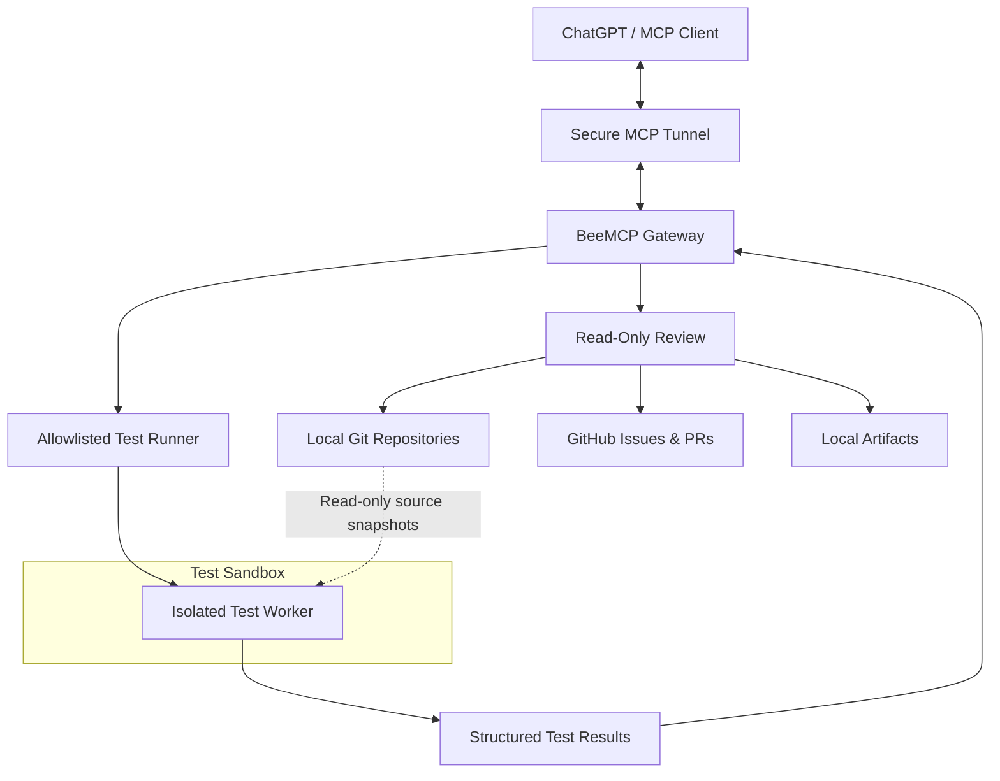

# BeeMCP

**A secure, self-hosted MCP gateway for AI-assisted code review and isolated local testing.**

BeeMCP connects ChatGPT to your local Git repositories, working trees, documentation, and GitHub context through the [Model Context Protocol (MCP)](https://modelcontextprotocol.io/).

It enables AI-assisted development and code review **without granting the AI permission to edit source files, execute arbitrary shell commands, or modify Git repositories**.

## Architecture



**BeeMCP Gateway** exposes a controlled set of MCP tools.

**Read-Only Review** provides access to configured repositories, Git changes, documentation, GitHub context, and local artifacts.

**Test Runner** executes predefined pytest suites inside a restricted Bubblewrap sandbox with resource and network limits.

**The AI can inspect code and request approved tests, but cannot modify the original repositories through BeeMCP.**

## Features

- **Repository context** — configurable projects, context modes, and Git worktree discovery.
- **Code review** — paginated Git inventory, diffs, and changed-source inspection.
- **Snapshot consistency** — detection of changing repository state during reviews.
- **GitHub integration** — read-only Issues, pull requests, reviews, and comments.
- **Artifact inspection** — bounded text reports, screenshots, images, PDF pages, and supported Office previews.
- **Isolated testing** — predefined pytest suites without arbitrary command execution.
- **Security controls** — project allowlists, secret filtering, filesystem isolation, network restrictions, and resource limits.

BeeMCP is a review and verification gateway, not a general-purpose remote terminal or autonomous coding agent.

## Quick Start

### Requirements

- Linux with `systemd --user`
- Python **3.14.4**
- Git and curl
- [uv](https://docs.astral.sh/uv/) — automatically bootstrapped if missing
- A configured `tunnel-client` and its control-plane credentials
- A ChatGPT environment supporting the provisioned MCP connection

For isolated testing, the host additionally requires rootless Bubblewrap, libseccomp, systemd/cgroup v2, and existing Python environments containing the necessary test dependencies.

LibreOffice (`soffice`) is optional for supported Office document previews.

### Installation

```bash
git clone https://github.com/beesyst/beemcp.git
cd beemcp
./start.sh
```

On first launch, BeeMCP creates `.env` from `.env.example` and reports missing configuration values.

Configure your credentials:

```dotenv
BEEMCP_TUNNEL_ID=your-tunnel-id
CONTROL_PLANE_API_KEY=your-control-plane-key
BEEMCP_GITHUB_TOKEN=your-read-only-github-token
```

Adjust the project paths in `config/projects.yml`, then start and verify the stack:

```bash
./start.sh
./start.sh doctor
```

A healthy installation reports **15 MCP tools**, contract **v7**, and active MCP and tunnel services.

> **Deployment requirement:** The tunnel client, its credentials, and ChatGPT connector provisioning are external prerequisites. Cloning BeeMCP does not automatically provide tunnel access or a connected ChatGPT app.

## Configuration

Projects and access limits are managed through:

```text
config/projects.yml
```

Example project registration:

```yaml
projects:
  myproject:
    source: ../../myproject
    base_branch: main
    github_repo: my-org/myproject

    context_modes:
      A:
        files:
          - README.md
          - docs/ARCHITECTURE.md

      B:
        extends: A
        files:
          - src
          - tests

      C:
        extends: B
        tree_roots:
          - src
          - tests
```

Project paths are resolved relative to `config/projects.yml`.

### Context Modes

| Mode  | Purpose                                        |
| ----- | ---------------------------------------------- |
| **A** | Architecture, policies, and key documentation  |
| **B** | Mode A plus implementation files and contracts |
| **C** | Mode B plus a bounded repository tree          |

Git worktrees are discovered automatically. BeeMCP verifies the exact repository, path, branch, and HEAD rather than relying on branch names alone.

GitHub access requires a fine-grained token with read-only permissions for the selected repositories. Keep credentials in `.env`, never in source control.

## MCP Tools

BeeMCP exposes **15 tools** across five areas.

| Area              | Tools                                                                                                    |
| ----------------- | -------------------------------------------------------------------------------------------------------- |
| Projects          | `list_projects`, `list_worktrees`, `get_project_context`                                                 |
| Review            | `get_review_manifest`, `get_review_bundle_page`, `get_review_sources_page`, `get_review_bundle`          |
| Files & artifacts | `read_project_file`, `search_project`, `read_local_artifact`, `read_local_visual`, `read_project_visual` |
| GitHub            | `get_github_context`                                                                                     |
| Testing           | `start_test_suite`, `get_test_result`                                                                    |

`get_review_bundle` is a bounded compatibility API. Full reviews should use the paginated review tools.

### Example: Code Review

Ask ChatGPT:

```text
Use BeeMCP to review the current changes in myproject.

Verify the branch, inspect the complete Git inventory,
review changed sources and public contracts,
and identify defects or missing verification.

Do not modify files.
```

For a complete review, BeeMCP provides a consistent snapshot across the manifest, diff, and changed-source pages. If the repository changes during inspection, the review must restart using a new snapshot.

### Example: Local Testing

```text
Use BeeMCP to run the allowlisted beeui_unit suite.

Report the exit code, passed, failed, skipped,
and any available diagnostic information.

Do not modify source files.
```

The MCP client can request a predefined suite and retrieve its status and results. It cannot supply arbitrary shell commands, executable paths, or pytest arguments.

## Isolated Test Runner

BeeMCP supports an optional, strictly allowlisted test runner.

Current configured suites:

| Project  | Suite                       | Coverage                                     |
| -------- | --------------------------- | -------------------------------------------- |
| BeeAgent | `beeagent_conversation_web` | Selected conversation and Web UI regressions |
| BeeUI    | `beeui_unit`                | Blocks, locale, navigation                   |
| BeeScan  | `beescan_unit`              | Catalog and domain                           |
| BeeMCP   | `beemcp_unit`               | Gateway and transport regressions            |

Enable or disable execution in `config/projects.yml`:

```yaml
test_runner:
  enabled: true
```

The provided configuration enables these suites. Set `enabled: false` to disable execution while retaining the MCP tool declarations.

### Execution Model

1. `start_test_suite(target, suite)` requests an allowed test suite.
2. BeeMCP prepares a bounded snapshot of eligible source files.
3. A sandboxed worker executes the configured pytest tests.
4. `get_test_result(job_id)` returns the job state and structured results.

The sandbox uses:

- Read-only source snapshots, including eligible uncommitted changes
- Bubblewrap filesystem and network namespaces
- Isolated writable temporary storage
- systemd/cgroup CPU, memory, and process limits
- Execution timeouts and bounded output
- Restricted access to host files and environment variables

Only one test job runs at a time.

If the required isolation cannot be established, BeeMCP refuses the job rather than running pytest directly on the host.

**Important:** These are selected regression suites, not full project test coverage. External security laboratories and unrestricted network tests are not available through this interface.

## Connect to ChatGPT

Once BeeMCP and the configured tunnel are running, connect the MCP endpoint through the provisioned ChatGPT connector.

After changing the MCP tool schema:

1. Restart BeeMCP with `./start.sh restart`.
2. Verify the server using `./start.sh doctor`.
3. Refresh the BeeMCP connector's actions/tools in ChatGPT, or reconnect if refreshing is unavailable.
4. Start a new chat.
5. Confirm that `start_test_suite` and `get_test_result` are available.

`doctor` validates the local MCP server and tool contract. It cannot verify that ChatGPT has refreshed its cached connector schema.

## Operations

BeeMCP uses a single entrypoint:

```bash
./start.sh <command>
```

| Command              | Description                                  |
| -------------------- | -------------------------------------------- |
| `./start.sh`         | Start the stack                              |
| `./start.sh setup`   | Configure local services                     |
| `./start.sh status`  | Check service status                         |
| `./start.sh doctor`  | Validate health, readiness, and MCP contract |
| `./start.sh logs`    | Follow service logs                          |
| `./start.sh restart` | Restart MCP and tunnel                       |
| `./start.sh stop`    | Stop the stack                               |

The stack runs through two user-level systemd services:

```text
beemcp.service
beemcp-tunnel.service
```

Health endpoints:

| Endpoint    | Purpose                                 |
| ----------- | --------------------------------------- |
| `/healthz`  | Liveness                                |
| `/readyz`   | Readiness                               |
| `/versionz` | Git HEAD and MCP tool-contract identity |

Manage generated systemd units and tunnel configuration through `start.sh`, not by editing generated files manually.

## Development

Run the BeeMCP test suite:

```bash
uv run python -m unittest discover -s tests -v
```

BeeMCP's own development tests use `unittest`. The optional sandbox runner uses pytest from existing project environments to execute its predefined suites.

Project structure:

```text
beemcp/
├── config/
│   ├── projects.yml
│   └── start.py
├── ops/systemd/
├── scripts/
├── tests/
├── server.py
├── mcp_contract.py
├── test_runner.py
├── test_worker.py
├── start.sh
├── pyproject.toml
└── uv.lock
```

## Security

BeeMCP follows a **least-privilege, read-only-by-default design**.

- No source editing, arbitrary shell execution, Git commits, pushes, merges, or branch changes through MCP.
- GitHub operations are restricted to read-only context retrieval.
- Project roots, accessible files, artifact formats, and executable test suites are explicitly constrained.
- Secret files, private keys, and Git metadata are excluded from test snapshots.
- Test execution runs inside an isolated environment, with no route to the external network.
- Repository content, GitHub responses, artifacts, and test output are treated as untrusted input.
- Test execution is a separate, explicitly limited capability; it is not equivalent to passive read-only access.

Bubblewrap and resource limits reduce risk, but sandboxing does not eliminate all risks associated with executing untrusted test code. BeeMCP is intended for trusted operators who control the configured project and suite allowlists.

## License

A license has not yet been declared. Add a `LICENSE` file before publishing BeeMCP as an open-source project.

---

**BeeMCP reads the code, verifies the changes, and runs approved tests — without giving AI control over your source repositories.**
